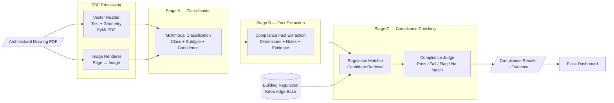
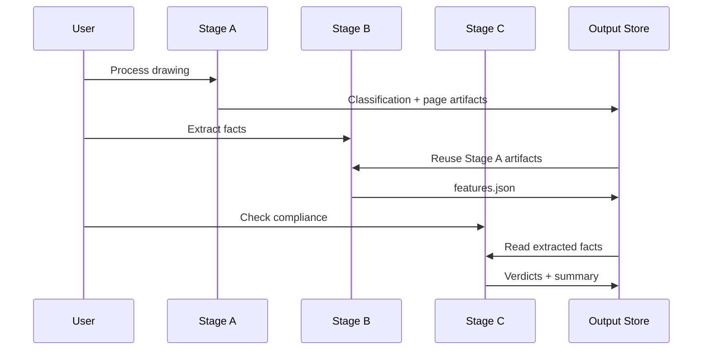

# AI-Powered Building Regulation Compliance Checking

An AI-powered system for analysing architectural drawing PDFs and evaluating compliance-relevant information against **Northern Ireland Building Regulations**.

Developed as an MSc Data Science project at **Ulster University** in collaboration with **EmrethinQ**, the system combines PDF vector extraction, computer vision and large language models to classify drawings, extract checkable facts, retrieve relevant regulatory guidance, and produce evidence-backed compliance verdicts.

The system is designed as a decision-support tool: uncertain or unsupported cases are explicitly flagged for human review rather than being forced into a pass/fail decision.

---

## Overview

Building-regulation reviews require professionals to interpret complex architectural drawings and compare specifications, dimensions and notes against regulatory requirements.

This project explores how AI can support that process while maintaining traceability and human oversight.

Given an architectural drawing PDF, the system:

1. **Classifies each drawing page** using both extracted PDF vector information and a rendered image.
2. **Extracts compliance-relevant facts** such as dimensions, U-values, mounting heights, material requirements and specification notes.
3. **Retrieves candidate regulatory guidance** from a building-regulation knowledge base.
4. **Evaluates each fact** against the retrieved regulatory evidence.
5. Produces one of four outcomes:
   - `pass`
   - `fail`
   - `flag`
   - `no_matching_clause`
6. Preserves the drawing evidence and regulatory evidence used to support each result.
7. Presents the results through a Flask-based web interface and dashboard.

---

## System Architecture



---

## Stage A — Drawing Classification

Architectural PDFs contain both visual information and machine-readable vector/text information.

Rather than relying on either representation alone, Stage A uses a **multimodal approach**:

```text
Drawing PDF
    │
    ├── Vector text + geometry
    │
    └── Rendered page image
             │
             ▼
       AI Classifier
             │
             ▼
    Drawing class + subtype
       + confidence score
```

The supported taxonomy includes:

**Architectural**
- Floor Plan
- Elevation
- Section
- Site Plan

**Engineering**
- Structural Plan
- Electrical Plan
- Mechanical Plan

**Finishes**
- Finishes Plan
- Reflected Ceiling Plan

**Safety**
- Fire Strategy Plan

The classifier also supports a **Not a drawing** category.

Low-confidence classifications can be surfaced for human review rather than silently treated as reliable.

---

## Stage B — Compliance Fact Extraction

Once a page has been classified, Stage B extracts explicit, checkable information from the drawing.

Examples include:

- dimensions
- mounting heights
- U-values
- material grades
- named standards
- specification requirements
- numerical requirements contained in drawing notes

The extraction process uses both the rendered drawing and its vector text.

A two-pass strategy is used:

1. **Whole-page extraction**
2. **Focused extraction of specification/note blocks**

Extracted facts preserve supporting evidence including:

```text
parameter_name
value
unit
fact_type
source_quote
source_bbox
page_number
page_class
page_subtype
```

The system is instructed not to estimate measurements from visual proportions or invent values that are not explicitly stated on the drawing.

---

## Stage C — Regulation Matching and Compliance Judgement

Stage C separates **information retrieval** from **compliance reasoning**.

### Part 1 — Regulation Matching

`matcher.py` searches the regulation knowledge base for candidate excerpts related to each extracted fact.

Search terms are constructed from:

- parameter name
- unit
- source quote

Candidate regulation chunks are ranked using keyword overlap.

This retrieval step is deterministic and does not require an AI API call.

### Part 2 — Compliance Judgement

The candidate excerpts are then passed to the compliance judge.

The judge determines whether the regulatory evidence genuinely applies to the extracted fact.

Four outcomes are supported:

| Verdict | Meaning |
|---|---|
| `pass` | A relevant requirement exists and the drawing satisfies it |
| `fail` | A relevant requirement exists and the drawing violates it |
| `flag` | The regulation appears relevant, but the available information is insufficient for a conclusive decision |
| `no_matching_clause` | None of the retrieved excerpts adequately address the fact |

The judge is explicitly instructed **not to assume that a retrieved regulation is relevant simply because the matcher returned it**.

This prevents unrelated keyword matches from automatically becoming compliance findings.

---

## Evidence and Traceability

A core design goal of the project is making automated findings independently reviewable.

An extracted fact can retain:

```text
Drawing
  ↓
Page
  ↓
Source quote
  ↓
Bounding-box coordinates
  ↓
Extracted parameter/value
```

A compliance verdict can retain:

```text
Extracted fact
  ↓
Verdict
  ↓
Reasoning
  ↓
Source regulation document
  ↓
Regulation excerpt
```

This creates an evidence trail between the original architectural drawing and the regulatory guidance used by the system.

---

## Example Compliance Finding

During testing, the system identified an electrical drawing specification where a kitchen socket-outlet height was stated as **1100 mm**.

The retrieved regulatory guidance specified a maximum height of **1000 mm**, resulting in a `fail` verdict.

The output retained the extracted drawing value, reasoning, source regulation document and regulatory excerpt so that the result could be independently reviewed.

> Test drawings used during the MSc project are not distributed in this public repository.

---

## Intermediate Processing

Each processing stage persists its results so downstream stages can reuse previous work.



This avoids unnecessarily repeating expensive upstream processing.

---

## Key Design Principles

### Evidence-first

Extracted facts retain evidence from the drawing, while compliance decisions retain the regulatory evidence used during judgement.

### Human review

The system is designed to support professional review rather than hide uncertainty. Ambiguous cases can be returned as `flag`, while unsupported cases can return `no_matching_clause`.

### Multimodal analysis

Architectural drawings contain information that may be represented visually, geometrically or textually. The pipeline combines rendered page imagery with PDF vector information.

### Separation of responsibilities

Classification, extraction, regulation retrieval and compliance judgement are separate stages. This makes intermediate results easier to inspect and debug.

### Cost-aware processing

Intermediate artifacts are persisted and reused. Deterministic retrieval is used where an AI call is unnecessary.

---

## Technology Stack

| Technology | Usage |
|---|---|
| Python | Core application and AI pipeline |
| Flask | Web application and results dashboard |
| PyMuPDF | PDF text/vector extraction and page rendering |
| OpenRouter | LLM access |
| Gemini 3.1 Flash Lite | Multimodal classification, extraction and judgement |
| OpenAI-compatible API | LLM client integration |
| Vercel Blob | Persistent storage for deployed environments |
| HTML / CSS / JavaScript | Web interface |
| JSON | Intermediate artifacts and structured results |

---

## Repository Structure

```text
.
├── app.py
├── requirements.txt
├── vercel.json
│
├── src/
│   ├── openrouter_client.py
│   ├── pipeline.py
│   ├── storage.py
│   │
│   ├── extraction/
│   │   ├── vector_reader.py
│   │   └── image_renderer.py
│   │
│   └── agents/
│       ├── classifier_agent.py
│       ├── feature_agent.py
│       ├── matcher.py
│       ├── judge.py
│       └── vision_transcriber.py
│
├── knowledge_base_schema/
│   └── clause_schema.json
│
├── templates/
├── static/
└── tests/
```

### Files intentionally excluded from the public repository

The following are kept outside version control:

```text
.env
data/
outputs/
knowledge_base/regulations_combined.txt
source regulation PDFs
```

This prevents credentials, project test drawings, generated artifacts and locally prepared regulation corpora from being unintentionally distributed.

---

## Installation

### Prerequisites

- Python 3.11+
- An OpenRouter API key

### 1. Clone the repository

```bash
git clone <repository-url>
cd <repository-name>
```

### 2. Create a virtual environment

**macOS / Linux**

```bash
python3 -m venv .venv
source .venv/bin/activate
```

**Windows**

```bash
python -m venv .venv
.venv\Scripts\activate
```

### 3. Install dependencies

```bash
pip install -r requirements.txt
```

### 4. Configure environment variables

Create a local `.env` file and configure the required API credentials.

```text
OPENROUTER_API_KEY=your_api_key_here
```

Never commit the `.env` file to version control.

### 5. Add test data

Create a local `data/` directory:

```bash
mkdir data
```

Place architectural drawing PDFs that you have permission to use inside this directory.

### 6. Configure the regulation knowledge base

The project expects the prepared regulation corpus at:

```text
knowledge_base/regulations_combined.txt
```

The corpus used during the MSc evaluation was derived from relevant Northern Ireland Building Regulations guidance documents.

The prepared corpus and source PDFs are intentionally not distributed with the public portfolio repository.

---

## Running the Application

### Web Interface

Start the Flask application:

```bash
python app.py
```

Then open:

```text
http://127.0.0.1:5000/
```

The interface supports drawing upload, individual pipeline stages, full processing and inspection of compliance results.

---

## Running Individual Stages

The processing stages can also be executed individually.

### Stage A — Classification

```bash
python -m src.agents.classifier_agent "data/your-drawing.pdf"
```

### Stage B — Fact Extraction

```bash
python -m src.agents.feature_agent "data/your-drawing.pdf"
```

### Stage C — Matching and Judgement

```bash
python -m src.agents.judge "data/your-drawing.pdf"
```

For testing, Stage C can be limited to the first `N` extracted facts:

```bash
python -m src.agents.judge "data/your-drawing.pdf" 5
```

---

## Generated Outputs

Processing results are stored locally under:

```text
outputs/<pdf-name>/
```

Typical artifacts include:

| File | Description |
|---|---|
| `page_NNN_vector.json` | Extracted PDF text spans and geometry |
| `page_NNN.png` | Rendered drawing page |
| `classification.json` | Drawing classification and confidence |
| `features.json` | Extracted compliance-relevant facts and evidence |
| `verdicts.json` | Individual compliance judgements |
| `verdicts_summary.json` | Aggregated verdict counts, failures and flagged items |

The `outputs/` directory is excluded from Git.

---

## Regulation Knowledge Base

The project implementation used a locally prepared corpus derived from Northern Ireland Building Regulations guidance documents, including technical guidance relating to:

- conservation of fuel and power
- accessibility
- fire safety

The current matcher operates over paragraph-level regulation chunks and retrieves candidates using keyword overlap.

The repository also contains:

```text
knowledge_base_schema/clause_schema.json
```

which defines a structured representation for individual regulation clauses and provides a foundation for future development of a more structured regulatory knowledge base.

---

## Limitations and Future Development

The current system demonstrates an end-to-end approach to AI-assisted building-regulation compliance checking, but several areas provide opportunities for further development.

Potential improvements include:

- converting the regulation corpus into structured clause records
- semantic or hybrid retrieval instead of keyword-only matching
- improved handling of cross-references and regulatory exceptions
- broader evaluation across additional drawing types and projects
- stronger automated test coverage
- expanded human-review workflows
- evaluation of alternative multimodal models
- richer visual evidence highlighting within drawings

---

## Project Context

This project was developed as an **MSc Data Science dissertation at Ulster University** in collaboration with **EmrethinQ**.

The work explored how multimodal AI and evidence-based reasoning could assist with automated checking of architectural drawings against building regulations while retaining traceability and human oversight.

**Academic Supervisor:** Kevin Curran  
**Industry Partner:** Omodono Emretane  
**Industry Collaboration:** EmrethinQ  
**School:** School of Computing, Engineering & Intelligent Systems, Ulster University

---

## Author

**Emmanuel Bajimi**

MSc Data Science — Ulster University